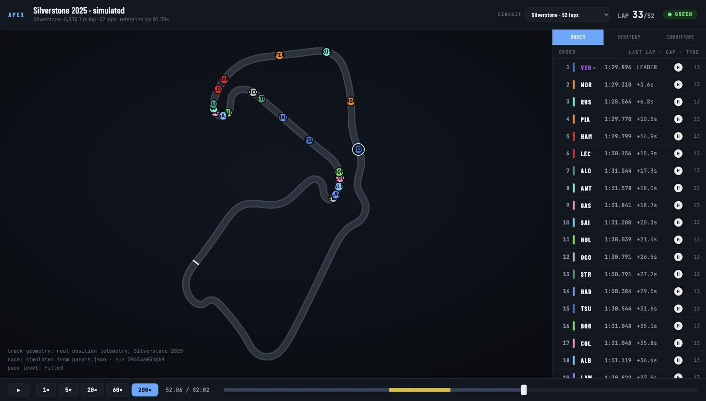

# APEX — a digital twin of a Formula 1 race

[](https://github.com/Suhas29wasnotavailable/apex-f1/actions/workflows/ci.yml)
[](https://suhas29wasnotavailable.github.io/apex-f1/)
[](LICENSE)

[](https://suhas29wasnotavailable.github.io/apex-f1/)

<sub>Silverstone, lap 33 of 52, simulated from the fitted parameters on the circuit traced from real
telemetry. **[Watch any of the 25 circuits in the browser →](https://suhas29wasnotavailable.github.io/apex-f1/)**</sub>

### At a glance

| | |
|---|---|
| **Fitted from** | 56 dry races at 25 circuits, 2022–2024 (50,583 laps), every parameter with a 95% interval |
| **Tested on** | the 21 dry races of 2025, held out from every fitted number |
| **Lap times** | essentially unbiased: mean error +0.14 s across 21,611 green laps |
| **Finishing order** | **loses to the grid baseline**: 2.86 places of error against 2.40, better in 5 of 21 races |
| **RL vs dynamic programming** | not measured yet. The baselines (P3) come first, then the PPO agent (P4) |

**The claim this repository exists to test:**

> Under deterministic dynamics, Formula 1 race strategy is a small enough MDP that dynamic
> programming solves it exactly, and reinforcement learning is therefore unnecessary. RL only
> earns its place under stochasticity — safety cars, degradation uncertainty, and reactive rivals.

That is a falsifiable claim. This repository measures it and reports the answer, **including if
reinforcement learning loses.**

> **Status: P2 (simulator and validation).** The simulator exists, runs on nothing but the fitted
> parameters, and has been measured against 21 races it has never seen. Every number below is
> regenerated by `make calibrate` and `make validate`. If a number cannot be regenerated, it is
> deleted.
>
> **It is still not called a digital twin, because it has not earned it.** On the measurement that
> matters most — where each car finishes — it is beaten by the baseline that predicts everybody
> finishes where they qualified. That result is published in full below.

## Watch a race

```bash
make tracks    # trace all 25 circuits from real telemetry (once, ~300 KB)
make replay    # simulate the whole calendar and open it
```

That writes one self-contained HTML file and opens it. No server, no build step, works offline.
**All 25 fitted circuits** are in it behind a picker, so you can watch the same twenty cars race at
Monaco and then at Monza and see the difference the fitted parameters make.

Three panels:

| Panel | What it shows |
|---|---|
| **Order** | Live timing tower — position, last lap, gap, tyre compound and age. Purple marks whoever holds the fastest lap, and it changes hands. |
| **Strategy** | Every car's race as proportional stints, so you can read the whole field's tyre plan at a glance. |
| **Conditions** | Air and track temperature traces, speed trap by team, and the compounds actually run — all **recorded, never simulated**. |

Two things in the view are real measurements rather than drawings. The **track outline** is traced
from FastF1 position telemetry, so Monaco has its hairpin and Silverstone has Maggotts–Becketts. And
cars move on a **real speed profile** taken from a fast lap, so they slow for the corners instead of
sliding round at a constant rate.

**About that Conditions panel.** This project is calibrated on dry races only, so there is no
weather model, no track-temperature effect and no engine model. The panel shows what the timing feed
actually recorded at each circuit — Mexico City runs at 46–53 °C of track temperature, Singapore at
33–35 °C, and the speed trap separates the teams by about 8 km/h — and says plainly that none of it
feeds the race you are watching. Showing a simulated rain shower would be inventing a number the
simulator does not have.

Everything else — who is where, on what tyre, how far apart — comes from `params/params.json` and
nothing else.

## What is being built

| Layer | What it is |
|---|---|
| **Simulator** | An event-driven, multi-car stochastic race model whose parameters — tyre degradation, pit loss, race-progress pace effect, safety-car hazard, overtaking difficulty — are **fit from real telemetry**, not invented. |
| **Agents** | Rule-based, dynamic-programming and MCTS baselines, built **before** a custom single-file PPO agent, so the comparison is honest. |
| **App** | A browser replay of a real Grand Prix on its true track geometry, where you can fork the twin at any lap, override a decision, and watch the counterfactual diverge from reality. |

"Digital twin" is a claim, not a label. The validation it has to pass now exists and it does not yet
pass: see [What the twin gets wrong](#what-the-twin-gets-wrong).

## What has been measured

Fitted from **56 dry races at 25 circuits** in 2022–2024, using 50,583 of 61,358 laps. All 92
races of 2022–2025 are ingested; the 21 dry races of 2025 are held out and have not been seen by
any of these numbers. Each carries a 95% interval; the full table, with per-circuit values and the
audit of every excluded lap, is written to `docs/calibration_report.md` by `make calibrate`.

| Parameter | Estimate |
|---|---|
| Tyre degradation — soft / medium / hard | 0.095 / 0.093 / 0.079 s per lap of tyre age |
| Compound pace — medium / hard, vs soft at equal age | +0.20 s / +0.31 s |
| Race progress — fuel burn and track evolution | −3.12 s from first lap to last |
| Dirty air — directly behind a car | +0.78 s, falling to +0.47 s at a one-second gap |
| Pit loss | 22.7 s pooled; 29.4 s at Marina Bay, 19.0 s at Spa-Francorchamps |
| Safety car | 0.0119 per green lap — 54% of races, lasting 4.8 laps |
| Virtual safety car | 0.0100 per green lap — 48% of races, lasting 2.9 laps |

Nothing here is hand-set, and the ordering matches the sport wherever that can be checked
independently: softer tyres are faster and wear out quicker, Singapore has the longest pit lane
and Spa among the shortest, and roughly two races in three see a neutralisation.

## What the simulator runs on

P2 added the parameters P1's estimator had no reason to publish, because a fixed-effects model
absorbs exactly what a simulator needs most — the absolute lap time, and which car is quick.

| Parameter | Estimate |
|---|---|
| Circuit pace level | 69.9 s at Spielberg to 110.8 s at Spa-Francorchamps |
| Season trend | −1.21 s per lap per season; 2022 cars 2.42 s slower than 2024 |
| Standing start | +7.9 s over a flying lap, from 31 green starts |
| Grid position → race pace | pole −1.05 s to P20 +0.49 s; r² 0.51, residual 0.47 s |
| **Pit loss under a safety car** | **14.3 s against 22.7 s green — an 8.4 s discount**, from 484 stops |
| Safety car | laps run 1.36× a green lap; the field closes at most 14.1 s per lap |
| Overtaking | 4.6% of adjacent pairs pass per lap, from 35,246 measured pairs |
| Overtaking by circuit | Monaco 0.58%, Zandvoort 2.7%, Las Vegas 10.5% |

Two of these are worth singling out. **Pit loss under a safety car** was the number P1 recorded as
the most strategically important one missing, and measuring it naively gives 65 seconds — three times
the green-flag cost — because comparing a neutralised stop against the driver's own green laps charges
the whole safety-car slowdown to the pit stop. Measured against the cars that stayed out, it is 14.3
seconds, and it is the reason safety cars decide races.

And **overtaking is the one parameter where per-circuit estimates are strong on their own.** Every lap
contributes roughly twenty adjacent pairs, so unlike the safety-car hazard — where between-circuit
variation was exactly zero — Monaco separates from Las Vegas by a factor of eighteen. That is the
correct answer, and P1 had no way to produce it.

## What the twin gets wrong

21 held-out 2025 races. The simulator is given the real grid, the real pit stops and the real safety
cars, and produces the racing; 18.1 classified finishers are compared per race.

| Mode | Position MAE | Grid baseline | Spearman | Winner | Lap MAE | Gap MAE |
|---|---|---|---|---|---|---|
| Pace level anchored to the weekend | 2.86 | **2.40** | 0.749 | 48% | 2.39 s | 21.0 s |
| Pace level predicted from the trend | 2.71 | **2.40** | 0.755 | 52% | 2.99 s | 20.4 s |
| *Oracle car pace — leakage, a diagnostic* | *2.53* | *2.40* | *0.785* | *48%* | *2.37 s* | *18.6 s* |

**Read the second column first.** A model that predicts everybody finishes where they qualified scores
2.40 places of mean error. The simulator scores 2.86, and beats that baseline in only 5 of 21 races.

What it does do well: rank correlation 0.75, the right winner in about half the races, 8.1 of the real
top ten inside its own top ten, and green-flag lap times that are essentially unbiased — mean error
**+0.14 s across 21,611 green laps**, against a fitted residual scale of 0.66 s.

The diagnosis is specific. Reality churns the running order slightly *more* than the simulator does —
2.75 places from the grid against 2.52 — so the twin is not over-shuffling the field. It shuffles
about the right amount and shuffles **different cars**, and two uncorrelated shuffles of that size
produce very nearly the error observed. What reality churns for is retirements, damage and driver
error, and none of those has a parameter in this model. The oracle row bounds the rest: handed each
car's true race pace, position error only reaches 2.53, still level with the baseline.

The remaining measured biases, both unfixed: neutralised laps run 6.2 s a lap too fast because one
closing rate describes the whole of a deployment, and yellow-flag laps — 3.8% of all car-laps — are
run as green.

Two things these numbers do **not** say, recorded in [`PROGRESS.md`](PROGRESS.md) rather than
smoothed over. The race-progress effect absorbs track evolution as well as fuel burn and this
design cannot separate them. And with two or three races per circuit, no circuit-level variation
in safety-car hazard is detectable at all — Monaco and Monza currently get the same rate, which
is certainly wrong and is what the data supports.

## Scope and honesty constraints

- **Real data only**, 2022–2025 race sessions via [FastF1](https://docs.fastf1.dev) — one aero
  regulation era, so that fitted coefficients are not silently non-stationary.
- **Dry races only.** Wet and mixed sessions are excluded from calibration and from the simulator.
- **Trained on 2022–2024, validated on a fully held-out 2025.** A temporal split, because the only
  useful test of a twin is whether it generalises forward.
- **Every fitted parameter carries an uncertainty estimate**, or it does not ship.
- **Determinism**: a given seed and config reproduce a run exactly.

Decisions and their reasons are recorded as ADRs in [`docs/adr/`](docs/adr/).
Phase-by-phase progress, breakages and open questions are in [`PROGRESS.md`](PROGRESS.md).

## Quick start

```bash
make setup       # install uv-managed Python 3.11 environment and git hooks
make check       # lint (ruff) + types (mypy strict) + tests (pytest)

make ingest      # download the pilot races (Bahrain and Monaco, all seasons)
make ingest-all  # download every race of 2022-2025 -- slow, and rate-limited to 500 calls/hour
make laps        # report what the exclusion rules keep, and what they cost
make calibrate   # fit every parameter, write params/ and the calibration report
make race        # simulate one race from a grid and print the result
make tracks      # trace every circuit's outline from real telemetry, once
make replay      # simulate the calendar and open a watchable top-down replay
make publish     # rebuild that replay and publish it to GitHub Pages
make validate    # measure the simulator against the held-out races and print the error
```

```bash
# One circuit, your own grid.
uv run apex replay --circuit Monaco --laps 78 --drivers VER,NOR,LEC,PIA,SAI,RUS,HAM,PER

# Or a few of them in one page.
uv run apex replay --circuit "Monaco,Monza,Suzuka,Las Vegas"
```

`make ingest-all` is safe to interrupt and re-run: races already on disk are skipped before their
session is fetched, so a pull stopped by the API rate limit resumes where it left off.

Further targets are added by the phase that makes them meaningful — there are no stub commands
that print "not implemented yet".

## Roadmap

| Phase | Deliverable | State |
|---|---|---|
| P0 | Scaffold, deterministic seeding, config, CI | ✅ done |
| P1 | Ingestion and parameter calibration from real telemetry | ✅ done |
| P2 | Simulator **and its validation against held-out races** | ✅ done |
| P3 | Classical baselines: rule-based, dynamic programming, MCTS | next |
| P4 | Custom PPO agent, and the deterministic-vs-stochastic experiment | |
| P5 | FastAPI + WebSocket serving layer | |
| P6 | Frontend: track replay, strategy Gantt, counterfactual fork | replay done |
| P7 | Ship: Docker Compose, deployed demo, model card, `LIMITATIONS.md` | |

## Licence

MIT — see [LICENSE](LICENSE).
